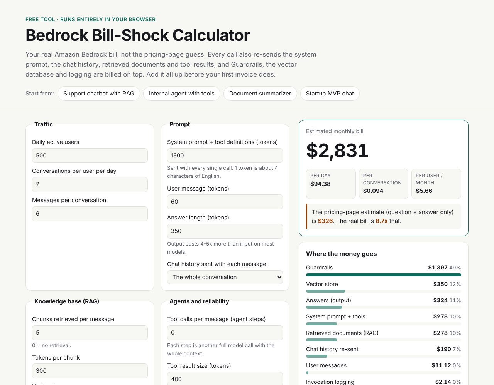

# Bedrock Bill-Shock Calculator

[](https://github.com/ObaidAbdullah16/bedrock-cost-calculator/actions/workflows/ci.yml)
[](https://ObaidAbdullah16.github.io/bedrock-cost-calculator/)

**Estimate your real Amazon Bedrock bill, not the pricing-page guess.** A free, static page:
no sign-up, no tracking, and nothing leaves your browser.

**Live:** https://ObaidAbdullah16.github.io/bedrock-cost-calculator/ (also on my portfolio under *Free tool*)



## Why

The first estimate for an LLM feature is usually *price per token x (question + answer)*.
Real applications send much more on every call:

| Hidden cost | What happens |
|---|---|
| System prompt and tool definitions | Sent with every single call |
| Chat history | Message 10 re-sends messages 1-9; input grows every turn |
| Retrieved documents (RAG) | 5 chunks x 300 tokens = 1,500 tokens per message |
| Agent loops | One question becomes 3-10 calls, each with the full context |
| Retries | Timeouts, throttling and broken JSON are billed again |
| Guardrails | Per 1,000 characters, per policy, on whatever you send them |
| Vector store | OpenSearch Serverless (classic) bills a minimum around the clock |
| Logging | Every prompt and answer stored in CloudWatch Logs |

The calculator adds all of it up and shows **how many times bigger the real bill is**. Then it
ranks concrete ways to cut it (prompt caching, a history window, fewer chunks, `max_tokens`,
batch, a cheaper model, a cheaper vector store) and shows how much each would save.

## Features

- 4 presets (support chatbot with RAG, internal agent, summarizer, MVP chat); every input editable
- 13 models with dated prices, plus your own price overrides
- Cost breakdown, cost per conversation and per user, and the pricing-page vs real multiplier
- Savings ideas with **Apply** buttons
- Share link (settings live after the `#`, which is never sent to a server) and a copyable summary
  for proposals
- Works offline: open `site/index.html` from disk. Light/dark, phone-friendly

## How it calculates

See [docs/METHOD.md](docs/METHOD.md). The maths is in [`site/calc.js`](site/calc.js) (no DOM, unit-tested),
prices in [`site/prices.js`](site/prices.js) with their sources and the date they were checked.

```bash
node --test               # 15 tests: hand-checked cases, caching, batch, guardrails, presets
open site/index.html      # or: python3 -m http.server -d site 8000
```

## Prices

Checked **26 Oct 2026**: US East (N. Virginia), on-demand Standard tier, Global cross-Region rate
where offered. They change often and differ by region; anything marked `*` is an assumption. CI
warns when the data is more than 90 days old. Always confirm on the
[AWS Bedrock pricing page](https://aws.amazon.com/bedrock/pricing/) before quoting.

## Hosting

- **GitHub Pages** (`pages.yml`): every push to `main` publishes `site/`. Set the repository
  variable `PORTFOLIO_URL` so "See the service" points to your portfolio.
- **Start / stop:** `bash scripts/up.sh` turns Pages on, sets `PORTFOLIO_URL` from `../_setup/config.env`
  when your domain is live, and publishes; `bash scripts/down.sh` takes the site offline (free either way).
- **Portfolio**: `portfolio/sync-demos.sh` copies `site/` to `/tools/bedrock-calculator/`.

Not affiliated with or endorsed by Amazon Web Services. Estimates only.

## License

MIT
